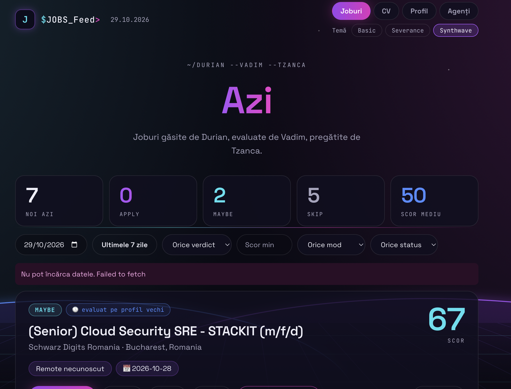

# Job Dashboard

<p align="center">
  
</p>

Dashboard pentru agenții Hermes care caută joburi: **Durian** le găsește, **Vadim** le evaluează, **Tzanca** propune modificări de CV, **Milchick** supervizează. Un singur proces Node (API Express + SQLite + interfață React), cu trei teme: Basic, Severance, Synthwave.

## Instalare pe un server nou
Ai nevoie de Linux cu systemd (testat pe Ubuntu), Node 20+, `git`, `rsync` și `curl`.

**1. Creează un utilizator normal** (recomandat; mai ales dacă pe acest server rulează și agenții Hermes). Un server nou vine de obicei doar cu `root`:
```bash
adduser hermes && usermod -aG sudo hermes
rsync --archive --chown=hermes:hermes ~/.ssh /home/hermes     # copiază cheia ta SSH, ca să te poți conecta direct ca hermes
```
Apoi te conectezi ca `hermes` și instalezi Hermes și aplicația cu acest utilizator.

**2. Instalează aplicația:**
```bash
git clone https://github.com/ravtechz/job-finder-hermes-framework.git ~/job-dashboard
cd ~/job-dashboard && ./install.sh
```
Scriptul face tot: build, utilizator de sistem `jobdash`, cod în `/opt/job-dashboard`, serviciu systemd, backup zilnic, comanda `sudo jobdash` și chei noi pentru agenți. Te întreabă și dacă vrei o parolă pentru dashboard (recomandat).

**3. Acces din laptop:** aplicația ascultă doar pe `127.0.0.1:3333`, deci o deschizi printr-un tunel:
```bash
ssh -L 3333:127.0.0.1:3333 hermes@server     # lasă sesiunea deschisă; apoi http://localhost:3333
```

**Securitate**
- Aplicația rulează sub utilizatorul dedicat `jobdash` (creat automat), fără login și fără `sudo`. E izolată: nu vede home-ul tău (nici `~/.hermes`), scrie doar în `/opt/job-dashboard/data`, iar `.env` și baza de date sunt citibile doar de `jobdash`. Dacă cineva execută cod prin aplicație (de exemplu printr-un SQL injection), rămâne în acest cont limitat.
- **Nu rula agenții Hermes ca root.** Ei execută comenzi și citesc anunțuri scrise de necunoscuți; un anunț cu instrucțiuni ascunse (prompt injection) ar rula comenzi cu drepturi depline: ar citi baza cu CV-ul, cheile și tot serverul. Ca utilizator normal, paguba rămâne în contul lui.
- `./install.sh` merge și ca root (de exemplu pe un server nou, doar pentru probe; comenzile `sudo` din README merg atunci fără `sudo`). `./install.sh --user` rulează aplicația ca tine, **fără** izolare: doar pentru încercări.

## Administrare
Comenzile cer drepturi de root: dacă ești utilizator normal, pune `sudo` în față (ca root, le scrii exact așa).
```bash
jobdash status          # starea serviciului și a backup-ului
jobdash restart         # repornire (după orice schimbare în .env)
jobdash logs -f         # loguri live (fără -f: ultimele 50 de linii)
systemctl stop job-dashboard      # oprire (pornire: start; la boot: enable / disable)
jobdash backup          # copie a bazei de date
nano /opt/job-dashboard/.env      # configurare (port, fus orar, chei, parolă); ca utilizator normal: sudoedit
```
**Loguri:** le gestionează systemd, deci sunt în jurnal: `sudo journalctl -u job-dashboard`. **Date:** baza SQLite e în `/opt/job-dashboard/data/`, backup-urile în `/opt/job-dashboard/backups/`.

**Actualizare:** `cd ~/job-dashboard && git pull && ./install.sh` (nu atinge `.env`, baza sau backup-urile).

## Conectarea agenților Hermes
Fiecare agent are nevoie de o cheie, de un `SOUL.md` și de instrucțiunile din [`AGENTS-API.md`](AGENTS-API.md). Cheile s-au generat la instalare: `AGENT_KEY` pentru Durian, Vadim și Tzanca, `ORCH_KEY` (doar citire) pentru Milchick.

1. **Vezi cheile** (opțional): `sudo grep -E '^(AGENT|ORCH)_KEY=' /opt/job-dashboard/.env`
2. **Pune-le în profilul fiecărui agent** (`~/.hermes/profiles/<agent>/.env`); comenzile le citesc singure din aplicație:
   ```bash
   KEY=$(sudo grep -m1 '^AGENT_KEY=' /opt/job-dashboard/.env | cut -d= -f2-)
   for a in durian vadim tzanca; do echo -e "\nAGENT_KEY=$KEY" >> ~/.hermes/profiles/$a/.env; done
   echo -e "\nORCH_KEY=$(sudo grep -m1 '^ORCH_KEY=' /opt/job-dashboard/.env | cut -d= -f2-)" >> ~/.hermes/profiles/milchick/.env
   ```
3. **Lasă cheia să ajungă la comenzile agentului.** Hermes ascunde implicit din comenzile din terminal variabilele care par secrete (nume cu `KEY`, `TOKEN`...). Agentul își trimite cheia cu `curl -H "X-Agent-Key: $AGENT_KEY"`; dacă variabila e ascunsă, e goală și primește `401`. Comenzile de mai jos o trec pe lista celor permise:
   ```bash
   for a in durian vadim tzanca; do hermes -p $a config set terminal.env_passthrough '["AGENT_KEY"]'; done
   hermes -p milchick config set terminal.env_passthrough '["ORCH_KEY"]'
   ```
4. **Dă fiecărui agent `SOUL.md`-ul lui.** `SOUL.md` descrie personalitatea și regulile agentului și îi spune să citească `AGENTS-API.md`, ca să știe cum să folosească dashboard-ul. Cele patru sunt gata făcute în [`agents/`](agents/) (`agents/<agent>/SOUL.md`). Le copiezi în profilurile Hermes (înlocuiesc `SOUL.md`-ul existent):
   ```bash
   cd ~/job-dashboard
   for a in durian vadim tzanca milchick; do cp agents/$a/SOUL.md ~/.hermes/profiles/$a/SOUL.md; done
   ```
   Sau, dacă vrei să le citești și să le schimbi pe parcurs, deschizi fiecare fișier în editor și lipești în el textul din `agents/<agent>/SOUL.md`:
   ```bash
   vi ~/.hermes/profiles/durian/SOUL.md     # la fel: vadim, tzanca, milchick
   ```
5. **Repornește Hermes și testează** din interiorul agentului (trebuie să răspundă `200`):
   ```bash
   systemctl --user restart hermes-gateway
   hermes -p vadim -z 'Rulează în terminal: curl -s -o /dev/null -w "%{http_code}" -H "X-Agent-Key: $AGENT_KEY" http://127.0.0.1:3333/api/jobs/pending-evaluation?limit=1'
   ```
   `401` = cheie lipsă sau greșită (sau pasul 3 nefăcut); `403` = rută nepermisă cheii respective.

Înainte de prima rulare încarcă CV-ul (tab-ul **CV**) și completează **Profil**: Vadim și Tzanca se opresc fără ele.

## Mai multe
Parolă, profil și reevaluare, butonul „Marchează APPLY” (pornirea automată a lui Tzanca), poze și model pentru agenți, teme, backup/restore, arhitectură: [`docs/DETALII.md`](docs/DETALII.md).

## Licență
[PolyForm Noncommercial 1.0.0](LICENSE): gratuit pentru uz necomercial, nu poate fi vândut. Copyright © 2026 ravtech.
