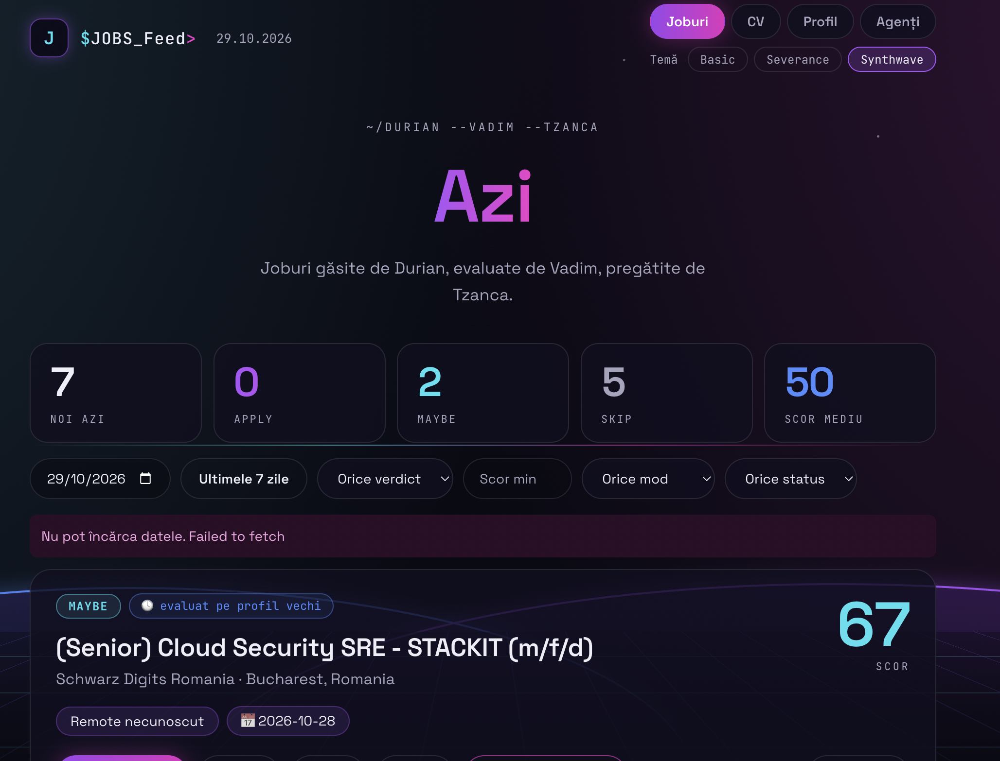

# Job Dashboard

<p align="center">
  
</p>

Dashboard pentru agenții Hermes care caută joburi: **Durian** le găsește, **Vadim** le evaluează, **Tzanca** propune modificări de CV, **Milchick** supervizează. Un singur proces Node (API Express + SQLite + interfață React), cu trei teme: Basic, Severance, Synthwave.

## Instalare pe un server nou
Ai nevoie de Linux cu systemd (testat pe Ubuntu), `sudo`, Node 20+, `git`, `rsync` și `curl`.

```bash
git clone https://github.com/ravtechz/job-finder-hermes-framework.git ~/job-dashboard
cd ~/job-dashboard && ./install.sh
```
Scriptul face tot: build, utilizator de sistem `jobdash`, cod în `/opt/job-dashboard`, serviciu systemd, backup zilnic, comanda `sudo jobdash` și chei noi pentru agenți.

**Securitate:** aplicația nu rulează ca tine și nu are root. Instalarea creează automat utilizatorul de sistem `jobdash`, fără login și fără `sudo`, iar serviciul rulează izolat sub el: nu vede home-ul tău (deci nici `~/.hermes`), nu poate obține privilegii în plus și scrie doar în `/opt/job-dashboard/data`. `.env` (cu cheile agenților) și baza de date sunt citibile doar de `jobdash`. Dacă cineva reușește să execute cod prin aplicație (de exemplu printr-un SQL injection), rămâne în acest cont limitat. Nu e un pas de făcut manual. `./install.sh --user` (pentru încercări) rulează aplicația ca tine, **fără** această izolare: nu-l folosi în producție. Te întreabă și dacă vrei o parolă pentru dashboard (recomandat). Aplicația ascultă doar pe `127.0.0.1:3333`; din laptop o deschizi printr-un tunel:

```bash
ssh -N -L 3333:127.0.0.1:3333 utilizator@server     # apoi http://localhost:3333
```

## Administrare
```bash
sudo jobdash status          # starea serviciului și a backup-ului
sudo jobdash restart         # repornire (după orice schimbare în .env)
sudo jobdash logs -f         # loguri live (fără -f: ultimele 50 de linii)
sudo systemctl stop job-dashboard      # oprire (pornire: start; la boot: enable / disable)
sudo jobdash backup          # copie a bazei de date
sudoedit /opt/job-dashboard/.env       # configurare (port, fus orar, chei, parolă)
```
**Loguri:** le gestionează systemd, deci sunt în jurnal: `sudo journalctl -u job-dashboard`. **Date:** baza SQLite e în `/opt/job-dashboard/data/`, backup-urile în `/opt/job-dashboard/backups/`.

**Actualizare:** `cd ~/job-dashboard && git pull && ./install.sh` (nu atinge `.env`, baza sau backup-urile).

## Conectarea agenților Hermes
Fiecare agent are nevoie de o cheie, de un `SOUL.md` și de instrucțiunile din [`AGENTS-API.md`](AGENTS-API.md). Cheile s-au generat la instalare: `AGENT_KEY` pentru Durian, Vadim și Tzanca, `ORCH_KEY` (doar citire) pentru Milchick.

1. **Ia cheile:** `sudo grep -E '^(AGENT|ORCH)_KEY=' /opt/job-dashboard/.env`
2. **Pune-le în profilul fiecărui agent** (`~/.hermes/profiles/<agent>/.env`):
   ```bash
   printf '\nAGENT_KEY=<valoarea>\n' >> ~/.hermes/profiles/vadim/.env     # la fel pentru durian și tzanca
   printf '\nORCH_KEY=<valoarea>\n'  >> ~/.hermes/profiles/milchick/.env
   ```
3. **Permite variabila în terminalul agentului**, altfel Hermes o ascunde (e „secretă”). În `~/.hermes/profiles/<agent>/config.yaml`:
   ```yaml
   terminal:
     env_passthrough:
       - AGENT_KEY        # ORCH_KEY pentru Milchick
   ```
4. **Dă-i `SOUL.md`:** gata făcute în [`agents/`](agents/) (Durian, Vadim, Tzanca, Milchick), cu exemple de `config.yaml`. `cp agents/vadim/SOUL.md ~/.hermes/profiles/vadim/` și la fel pentru ceilalți; ele îi trimit agentului la `AGENTS-API.md`.
5. **Repornește Hermes și testează** din interiorul agentului (trebuie să răspundă `200`):
   ```bash
   systemctl --user restart hermes-gateway
   hermes -p vadim -z 'Rulează în terminal: curl -s -o /dev/null -w "%{http_code}" -H "X-Agent-Key: $AGENT_KEY" http://127.0.0.1:3333/api/jobs/pending-evaluation?limit=1'
   ```
   `401` = cheie lipsă sau greșită (sau pasul 3 nefăcut); `403` = rută nepermisă cheii respective.

Înainte de prima rulare încarcă CV-ul (tab-ul **CV**) și completează **Profil**: Vadim și Tzanca se opresc fără ele.

## Mai multe
Parolă, profil și reevaluare, butonul „Marchează APPLY” (pornirea automată a lui Tzanca), poze și model pentru agenți, teme, backup/restore, arhitectură: [`docs/DETALII.md`](docs/DETALII.md).

## Licență
[PolyForm Noncommercial 1.0.0](LICENSE): gratuit pentru uz necomercial, nu poate fi vândut. Copyright © 2026 ravtech.
